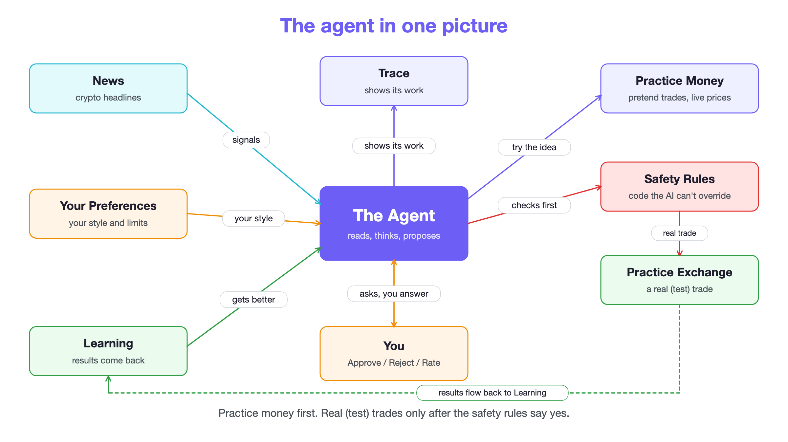
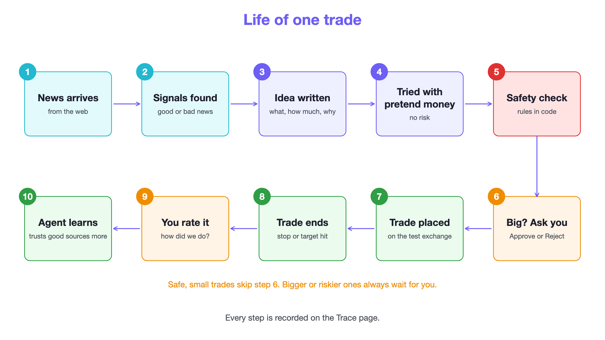
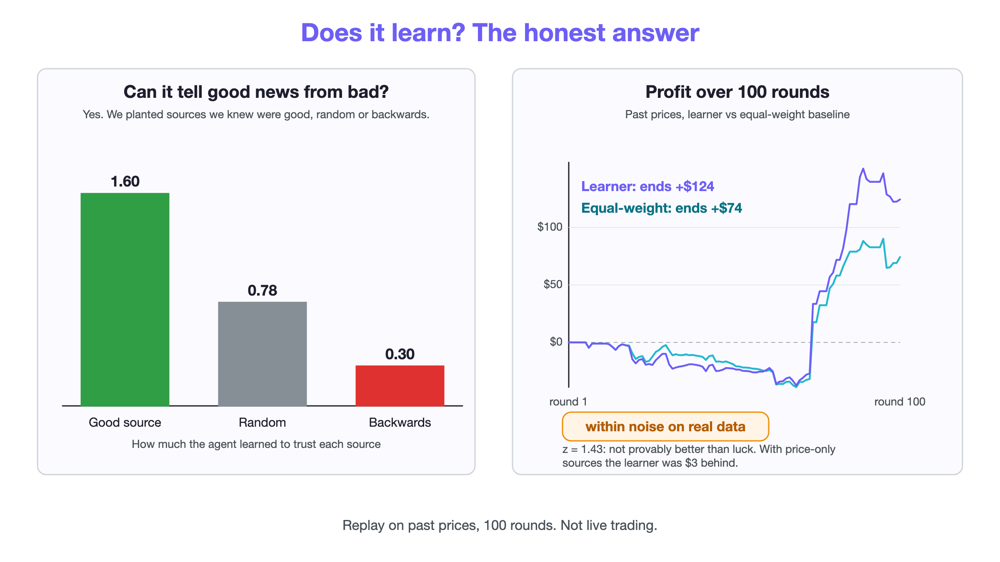
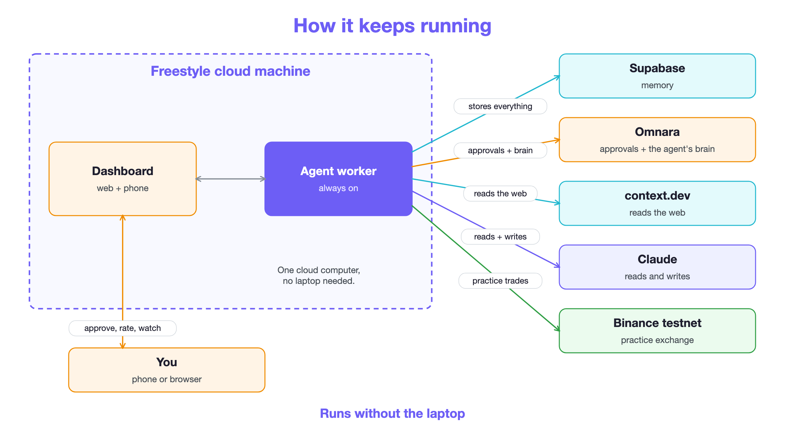

# Practice-First Trading Agent

> An always-on AI that reads crypto news, **rehearses every idea with pretend money**, and **asks you before anything risky**. Every step is traced, and we test honestly whether it learns.

Built for the Agent Builders Hackathon. Practice money on an exchange **testnet**; not financial advice.

- **Live demo:** https://trading-agent-b9ea.style.dev (password protected; judges: see the Devpost private testing instructions)
- **Worker health:** https://trading-agent-b9ea-worker.style.dev/health
- **Project story:** [`docs/PROJECT_STORY.md`](docs/PROJECT_STORY.md) · **Status and honest results:** [`docs/SESSION.md`](docs/SESSION.md)



## What it does

1. **Listen.** [context.dev](https://context.dev) searches the web for crypto news; Claude Haiku turns each article into structured signals.
2. **Think.** Claude Sonnet writes trade ideas (entry, stop, target, size, rationale) from the last day of signals, the user's preferences, and learned source trust. Code validates every idea: the entry is forced to the live price, stops and targets must be on the correct sides, size is clamped.
3. **Practice.** Every idea runs on a simulator with modelled fills and fees first.
4. **Check, then ask.** A deterministic rules engine (kill switch, banned coins, size, exposure, daily loss, order rate) evaluates the idea. Large or low-confidence ideas go to the user as **Approve / Reject** through Omnara or the dashboard. The model cannot skip this: `place_order` refuses to execute without an approval record.
5. **Act.** Approved longs also place a real order on the Binance.US **testnet**. The testnet is spot-only, so shorts are practice-only.
6. **Learn.** Closed trades update how much each source is trusted; the user rates trades (Good call / Bad call / Too risky); the simulator recalibrates itself from real fills.

Every step is recorded on the dashboard's **Trace** page in plain English: the news read, signals found, reasoning, rules checked, decision, and result.



## Does it learn? The honest answer

We built the evidence rather than assume it. Replays are walk-forward (the agent only sees the past) and a test proves there is no look-ahead.

| Test | Result |
|---|---|
| 100-round replay, learner vs equal weights (real prices) | +124 vs +74 USD, but z = 1.43: **within noise**; real price-only sources: 3 USD behind |
| **Time machine**: 25 random windows, learn 30 rounds, **freeze**, test on 20 unseen rounds | Real sources: mean gain -0.61 USD, 95% CI [-15.06, +13.84]: **no reliable improvement**. With planted sources of known edge: +13.12 USD, CI [+5.41, +20.83], learner won 18/25 (p = 0.043) |
| Planted-truth ranking | Learner ranked good > random > backwards sources correctly |
| Claude writing ideas with vs without learned lessons | Lessons **did not help** (-12 vs +46 USD over 100 rounds); diagnosed, live prompt fixed, fix **not yet shown** to work |

So the learning mechanism works when there is an edge to find, and on this real data there was almost nothing to find. We say so on screen. A live control group (learned vs equal weights, practice-only) keeps testing going forward.



## Architecture



| Piece | Role |
|---|---|
| **Omnara** | Hosts the agent (`ask_question` for humans, custom `place_order` tool); our worker polls tool calls and posts results |
| **Freestyle** | One VM runs the worker and dashboard as always-on systemd services behind `*.style.dev` HTTPS |
| **Supabase (Postgres)** | Memory: signals, theses, approvals, trades, lessons, cycles, replay results, trace events. Row-level security everywhere; the browser never touches the DB |
| **context.dev** | Web search and page text (calls and credits are counted on the Integrations page) |
| **Claude** | Haiku for extraction, Sonnet for ideas |
| **Binance.US testnet** | Practice exchange behind an `ExchangeAdapter` interface the simulator also implements |

Dashboard pages: Overview, Feed, Approvals, Demo, Trace, Cycles, Replay (100-round replay, time machine, live control group), Execution (practice vs real fills), Integrations, Safety, Learning, Preferences.

## Repo layout

```
apps/worker/        agent worker: loop, guardrails, simulator, exchange adapter, ingest, thesis,
                    watcher, feedback, learning, replay, rolling (time machine), shadow, commands
apps/dashboard/     Next.js dashboard (server routes only; optional password gate)
packages/shared/    shared TypeScript types
supabase/migrations/ database schema (apply with scripts/migrate.mjs)
scripts/            deploy-freestyle.mjs, migrate.mjs, replay and diagram generators, spikes
docs/               project story, status, deploy runbook, diagrams
deploy/             systemd unit templates
```

## Run it

```bash
cp .env.example .env            # fill in keys; never commit .env
npm install
node --env-file=.env scripts/migrate.mjs                      # create the schema
cd apps/worker && node --experimental-strip-types --env-file=../../.env src/index.ts create   # launch an Omnara agent
node --experimental-strip-types --env-file=../../.env src/index.ts serve                      # run the worker
cd ../dashboard && npm run dev                                 # dashboard on :3000
```

Tests: `node --experimental-strip-types --test apps/worker/test/ apps/worker/test/**/*.test.ts apps/worker/src/core.test.ts` and `npm test` in `apps/dashboard`.

Deploy to Freestyle: see [`docs/DEPLOY.md`](docs/DEPLOY.md) (`node --env-file=.env scripts/deploy-freestyle.mjs deploy`, then `redeploy`).

Reproduce the replays (free, no Claude calls): `node --experimental-strip-types scripts/replay-100.mjs` and `node --experimental-strip-types scripts/replay-rolling.mjs`.

## Safety and honesty

- Safety rules are plain, unit-tested code between the model and any order. The model's only power is to ask.
- Secrets live only in a local `.env` and an owner-only copy on the VM. Scripts redact errors; the repository and its history were scanned for leaked keys.
- Demo price moves, planted sources, and the practice engine are always labelled as simulated, and demo trades are excluded from the practice-vs-real comparison.
- Replay results are historical and not indicative of future performance.
